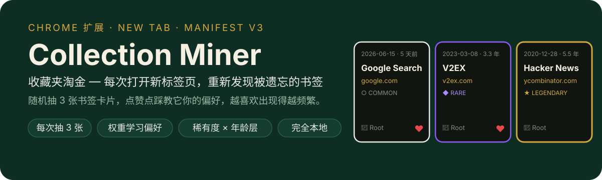
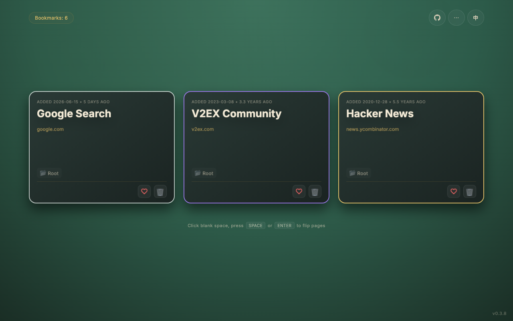

<p align="right"><a href="README.md">中文</a></p>

<p align="center">
  
</p>

<p align="center">
  <a href="https://xiaosang.cc/collection-miner/">▶ Privacy Policy &amp; Intro</a>
  ·
  <a href="https://github.com/holynova/collection_miner">GitHub Repository</a>
</p>

Collection Miner is a Chrome extension (Manifest V3, v0.4.0) that takes over your new tab page: every time you open one, it draws 3 bookmarks from your library by weight and shows them as cards. Liking a bookmark makes it more likely to be drawn again; disliking does the opposite — the system learns your taste over time. Everything stays local; nothing is collected or transmitted.

## Screenshot

<p align="center">
  
</p>

## Features

- **Dynamic weights**: each bookmark's draw weight = 1 + likes − dislikes (min 0.2); the system tracks every bookmark's impressions, clicks and like/dislike counts. The last 60 drawn bookmarks are held back from immediate repeats (when you have 12+ bookmarks).
- **Rarity tiers** by net score (likes − dislikes): 传说 Legendary (gold, ≥ +5), 稀有 Rare (purple, ≥ +2), 普通 Common (white), 诅咒 Cursed (dark, negative score).
- **Age tiers** by when you saved the bookmark: gold (5yr+), purple (3yr+), blue (2yr+), green (1yr+), white (under 1yr) — each with its own card-border sheen.
- **Card interactions**: click a card to open the link in a new tab (counts a click); ♥ to like and raise its weight; 🗑 to delete the bookmark (undoable within 8 seconds, with a custom confirmation dialog).
- **3D cards**: mouse-driven tilt with a cursor-following halo, title/link/metadata split across 4 parallax layers (60px / 38px / 20px / 0px), and a 3D flip animation on refresh. Three card-back themes: 皇家经典 (Royal Classic), 赛博霓虹 (Cyber Neon), 星空极简 (Celestial Minimal).
- **Quick refresh**: the 「再翻三张」 ("Draw three more") button, `Enter` / `Space`, or clicking any blank space on the page.
- **Data management**: export data / import a backup from the `⋯` menu in the top-right corner (local JSON file `collection_miner_backup_<date>.json`).
- **More**: Chinese/English UI toggle; when multiple new tabs from this extension are detected, one click on 「关闭其他」 ("Close others") shuts the extras.

## Install

The Chrome Web Store listing is coming soon; for now, install manually:

1. Download or clone this repo
2. Open `chrome://extensions` and turn on 「开发者模式」 (Developer mode) in the top-right corner
3. Click 「加载已解压的扩展程序」 (Load unpacked) and select this project folder

Package for release: `./zip_extension.sh` (produces `collection_miner-vX.X.X.zip`, containing only the files the extension needs to run).

## Privacy

Runs entirely locally — no data collected or transmitted. Bookmark data and weights live only in the browser's local storage; the extension asks for just three permissions: `bookmarks` (read bookmarks), `storage` (store weights and history), `tabs` (detect duplicate tabs).

→ [Full privacy policy](https://xiaosang.cc/collection-miner/) (also see `PRIVACY.md`)

## Tech

- Manifest V3, zero build, zero dependencies: `service-worker.js` flattens the bookmark tree and syncs it to `chrome.storage.local` on install, startup and bookmark changes; the new tab page draws cards from the local snapshot.
- Version history in `CHANGELOG.md` (bookmarks-only focus since v0.4.0).

```
manifest.json       MV3 manifest: newtab takeover, bookmarks/storage/tabs permissions
newtab.html         New tab page structure
newtab.css          Card, 3D parallax, rarity/age-tier styles
newtab.js           Drawing, weights, rarity/age tiers, import/export, duplicate-tab detection
service-worker.js   Bookmark-tree sync to local storage
icons/              16/48/128 icon sizes
store-assets/       Store promo images and screenshots
docs/index.html     Privacy policy page
```
