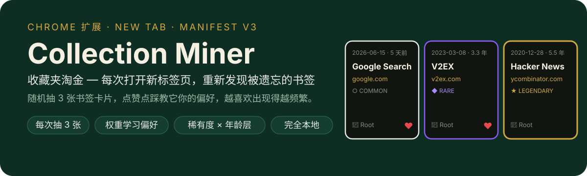
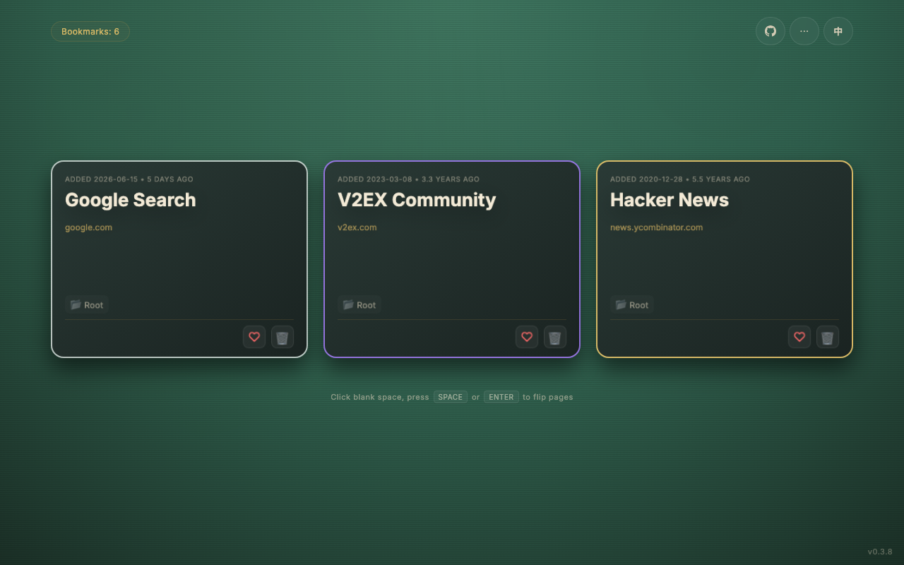

<p align="right"><a href="README.en.md">English</a></p>

<p align="center">
  
</p>

<p align="center">
  <a href="https://xiaosang.cc/collection-miner/">▶ 隐私政策与介绍</a>
  ·
  <a href="https://github.com/holynova/collection_miner">GitHub 仓库</a>
</p>

Collection Miner（收藏夹淘金）是一款 Chrome 扩展（Manifest V3，v0.4.0），接管你的新标签页：每次打开，从书签库里按权重随机抽 3 条，以卡片形式呈现。点赞让一条书签以后更容易被抽到，点踩则相反——系统会学习你的偏好，让真正喜欢的书签出现得更频繁。全部数据只存本地，不收集、不传输。

## 截图

<p align="center">
  
</p>

## 功能

- **动态权重**：每条书签的抽取权重 = 1 + 点赞数 − 点踩数（最低 0.2）；系统追踪每条书签的展示、点击、赞/踩次数。最近抽过的 60 条会暂缓重复出现（书签总数 ≥ 12 时生效）。
- **稀有度**：按赞踩净分（赞 − 踩）分级——传说 Legendary（金，≥ +5）、稀有 Rare（紫，≥ +2）、普通 Common（白）、诅咒 Cursed（暗，净分为负）。
- **年龄层**：按收藏时间分级——金（5 年+）、紫（3 年+）、蓝（2 年+）、绿（1 年+）、白（1 年内），卡片边框光泽各不相同。
- **卡片交互**：点击卡片在新标签页打开链接（记一次点击）；♥ 点赞提升权重；🗑 删除书签（8 秒内可撤销，自定义确认弹窗）。
- **3D 卡片**：鼠标跟随倾斜 + 光标光晕，标题/链接/元数据分 4 层视差（60px / 38px / 20px / 0px）；刷新时 3D 翻转动画。卡背 3 种主题：皇家经典、赛博霓虹、星空极简。
- **快捷刷新**：点「再翻三张」按钮、按 `Enter` / `空格`、或点页面任意空白处。
- **数据管理**：右上角 `⋯` 菜单可导出数据 / 导入备份（本地 JSON 文件 `collection_miner_backup_日期.json`）。
- **其他**：中英文界面切换；检测到多个本插件新标签页时，提供一键「关闭其他」。

## 安装

Chrome 应用商店版本即将上架，目前手动安装：

1. 下载或克隆本仓库
2. 打开 `chrome://extensions`，开启右上角「开发者模式」
3. 点击「加载已解压的扩展程序」，选择本项目文件夹

打包发布：`./zip_extension.sh`（生成 `collection_miner-vX.X.X.zip`，只含扩展运行必需文件）。

## 隐私

完全本地运行，不收集、不传输任何数据。书签数据与权重只存在浏览器本地存储中；权限只有三项：`bookmarks`（读书签）、`storage`（存权重与历史）、`tabs`（检测重复标签页）。

→ [完整隐私政策](https://xiaosang.cc/collection-miner/)（另见 `PRIVACY.md`）

## 技术

- Manifest V3，零构建、零依赖：`service-worker.js` 在安装/启动/书签变化时把书签树拍扁同步到 `chrome.storage.local`，新标签页从本地快照抽卡。
- 版本历史见 `CHANGELOG.md`（v0.4.0 起专注书签管理）。

```
manifest.json       MV3 清单：newtab 接管、bookmarks/storage/tabs 权限
newtab.html         新标签页结构
newtab.css          卡片、3D 视差、稀有度/年龄层样式
newtab.js           抽卡、权重、稀有度/年龄层、导入导出、重复标签页检测
service-worker.js   书签树同步到本地存储
icons/              16/48/128 三档图标
store-assets/       应用商店宣传图与截图
docs/index.html     隐私政策页
```
